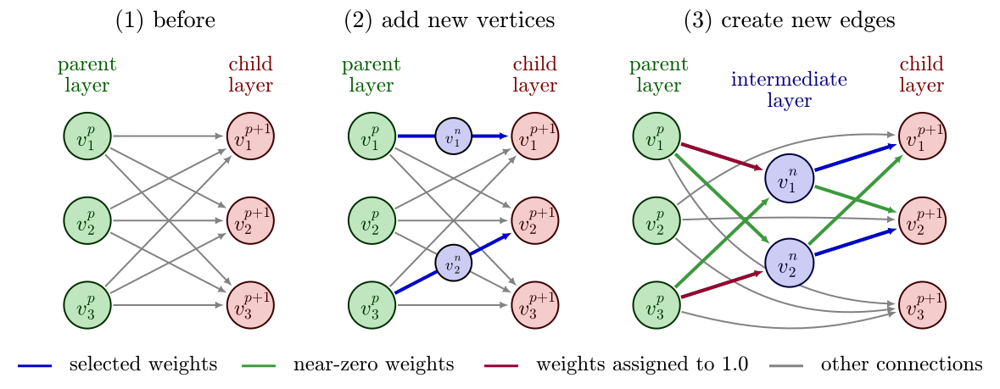

# SSONN: Self-Scaled Optimized Neural Network

## Overview

SSONN introduces an innovative approach to building neural networks that dynamically grow during training, starting from a minimal structure and intelligently adding connections where they are most impactful. Unlike traditional methods that begin with large networks and prune them, SSONN creates sparse, efficient networks with significantly fewer parameters, reducing computational costs while maintaining high accuracy. This makes it ideal for resource-constrained devices.

The system automatically identifies and adds connections based on their contribution to learning, achieving performance comparable to dense networks with a fraction of the parameters. Experiments demonstrate promising results on image recognition tasks, with ongoing work to expand layer support and mitigate overfitting risks.



## Installation

To set up SSONN, install the required dependencies using the following commands:

```bash
%pip uninstall ssonn
%pip install -U -e .
```

**Note**: Python 3.10 or 3.11 is recommended for optimal compatibility.

## Training and Evaluation

| Dataset | Path | Weights |
| ------- | ---- | ------- |
| MNIST |  [mnist.ipynb](experiments/training/mnist.ipynb) | [link](https://drive.google.com/file/d/1CsDBrzTzQtdIOACsUZEs-XzTS2Wd7GFe/view?usp=sharing) |
| Fashion-MNIST | [fashion_mnist.ipynb](experiments/training/fashion_mnist.ipynb) | [link](https://drive.google.com/file/d/18Re93V_PgoqTeMKLxvcY1H7SEZ2SArNy/view?usp=sharing) |
| Gutenberg | [gutenberg.ipynb](experiments/training/nas_unseen_experiments/Gutenberg.ipynb) | [link](https://drive.google.com/file/d/18yYbL89Cc-4hUPNq2Ht8d8MrXzpUiElN/view?usp=sharing) |
| MultNIST | [multnist.ipynb](experiments/training/nas_unseen_experiments/multnist.ipynb) | [link](https://drive.google.com/file/d/1qN8tOU2oqDJL9FwWl_9W3RsRX2L6xtVW/view?usp=sharing) |
| AddNIST | [addnist.ipynb](experiments/training/nas_unseen_experiments/addnist.ipynb) | [link](https://drive.google.com/file/d/1_sUu99tWR9qQHVZv3Fut7zvny6u2lMvz/view) |
| CIFARTile | [ctile.ipynb](experiments/training/nas_unseen_experiments/ctile.ipynb) | [link](https://drive.google.com/file/d/1398YdTJQp2jcSg8O_WlzD5jeRt4CjFoc/view?usp=sharing) |
| Chesseract | [chesseract.ipynb](experiments/training/nas_unseen_experiments/chesseract.ipynb) | [link](https://drive.google.com/file/d/1uXgxIeJWaBqEbNzPxJcO4fu-Vw2XIXDi/view?usp=sharing) |
| GeoClassing | [geoclassing.ipynb](experiments/training/nas_unseen_experiments/geoclassing.ipynb) | [link](https://drive.google.com/file/d/1WGMBwHyK3Fj40L4L3KOheEUHr51msRnA/view?usp=sharing) |
| Language | [language.ipynb](experiments/training/nas_unseen_experiments/language.ipynb) | [link](https://drive.google.com/file/d/1eVM13_f4REQOlJVXbUnGnINpucgEI7i7/view?usp=sharing) |

Other experiment can be found in the `experiments/training` folder.

## Results

### Training Time

- **MNIST**: 598 seconds
- **Fashion-MNIST**: 2177 seconds

### Performance on MNIST and Fashion-MNIST

#### MNIST

| Model        | Accuracy (%) | Parameters   | Type |
|--------------|--------------|--------------|------|
| BMCNNwHFCs   | **99.87**    | 1,514,187    | CNN  |
| VGG-5        | 99.69        | 3,646,000    | CNN  |
| MLP          | 99.25        | 2,900,000    | MLP  |
| DNN-5        | 97.20        | 575,051      | MLP  |
| **SSONN**    | 97.78        | **82,436**   | MLP  |

#### Fashion-MNIST

| Model         | Accuracy (%) | Parameters     | Type |
|---------------|--------------|----------------|------|
| Inception v3  | **94.44**    | 27,161,264     | CNN  |
| ResNet-18     | 92.28        | 11,689,512     | CNN  |
| CTM-8000      | 91.50        | **527,250**    | TM   |
| **SSONN**     | 89.41        | 555,359        | MLP  |

### Performance on Unseen NAS Datasets

SSONN results are averaged over 10 runs (mean ± 3 std). Accuracy is reported in %, and training time is in seconds.

| Model        | Params (M) | Gut.   | Mult-N. | Add-N. | C-Tile | Chess. | Geo.   | Lang.  |
|--------------|------------|--------|---------|--------|--------|--------|--------|--------|
| ResNet-18    | 11.7       | **49.98** | 91.55   | 92.08  | 45.56  | 57.83  | 80.33  | **97.00** |
| AlexNet      | 61.1       | 45.53  | 94.01   | 94.87  | 48.88  | 57.45  | 92.49  | 85.71  |
| VGG16        | 138        | 44.00  | 90.43   | 92.06  | 24.43  | 55.69  | 93.67  | 84.54  |
| ConvNext     | 88.6       | 31.93  | 64.20   | 38.06  | 31.06  | 52.74  | 72.76  | 83.40  |
| MNASNet      | 4.4        | 38.00  | 87.70   | 90.51  | 48.49  | 56.26  | 86.00  | 84.63  |
| DenseNet     | 28.7       | 43.28  | 92.81   | 93.52  | 51.28  | 59.60  | 94.21  | 84.57  |
| ResNeXt      | 25.0       | 40.30  | 90.57   | 91.42  | 46.23  | 55.15  | 89.99  | 93.97  |
| PC-DARTS     | --         | 49.12  | 96.68   | 96.60  | **92.28** | 57.20 | 94.61  | 90.12  |
| DrNAS        | --         | 46.62  | **98.10** | 97.06  | 81.08  | 58.24  | **96.03** | 88.55  |
| Bonsai-Net   | --         | 48.57  | 97.17   | **97.91** | 91.47  | 60.76  | 95.66  | 87.65  |
| DARTS        | --         | 47.72  | 96.55   | 97.07  | 90.74  | 59.16  | 95.54  | 90.12  |
| Bonsai       | --         | 29.00  | 39.76   | 34.17  | 24.76  | **68.83** | 63.56 | 76.83  |
| Random       | --         | 16.60  | 10.00   | 5.00   | 25.00  | 10.00  | 10.00  | 10.00  |

**SSONN Results**

|               | Gut.       | Mult-N.    | Add-N.    | C-Tile    | Chess.    | Geo.      | Lang.     |
|---------------|------------|------------|-----------|-----------|-----------|-----------|-----------|
| Acc (%)       | 42.15±0.82 | 80.02±0.77 | 47.02±1.89 | 25.98±0.63 | 58.49±0.50 | 26.24±1.84 | 83.37±0.24 |
| Params (M)    | **0.72**±0.12 | 5.72±0.71 | 9.35±0.82 | **0.62**±0.09 | **1.34**±0.39 | **1.10**±0.24 | **0.69**±0.11 |
| Train time (s)| 473        | 5427       | 7894      | 343       | 529       | 1475      | 185       |

### Comparison with Pruned Architectures (MNIST & Fashion-MNIST)

| Model              | Original Params (M) | MNIST Acc (%) | F-MNIST Acc (%) | Pruned Params (M) MNIST | Acc (%) | Pruned Params (M) F-MNIST | Acc (%) |
|--------------------|---------------------|---------------|------------------|--------------------------|---------|----------------------------|----------|
| ResNet-18         | 11.18               | 99.01         | 91.95            | 2.80                     | 97.31   | 1.13                       | 89.38    |
| ResNeXt-50        | 23.00               | 98.70         | 91.71            | 5.75                     | 97.72   | 0.87                       | 89.10    |
| MNASNet-1         | 3.12                | 98.48         | 90.83            | 0.55                     | 97.40   | 0.59                       | 89.40    |
| EfficientNet-V2-S | 20.19               | 99.17         | 92.50            | 1.82                     | 97.65   | 1.17                       | 84.37    |
| MobileNet-V3-S    | 1.53                | 98.54         | 90.11            | 0.10                     | 97.54   | 0.11                       | 89.29    |
| **SSONN (Ours)**  | —                   | —             | —                | **0.08**                 | **97.78** | **0.56**                   | **89.41** |
